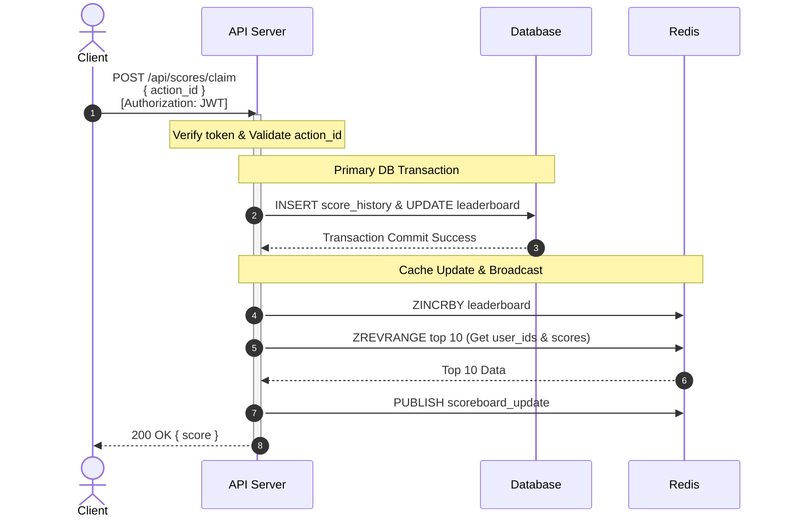
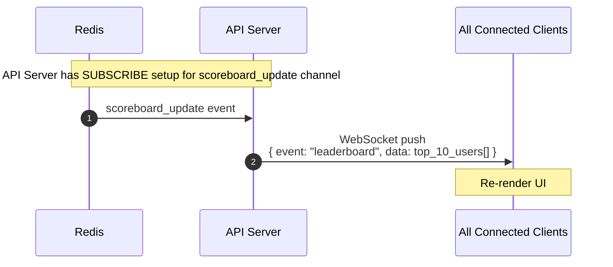
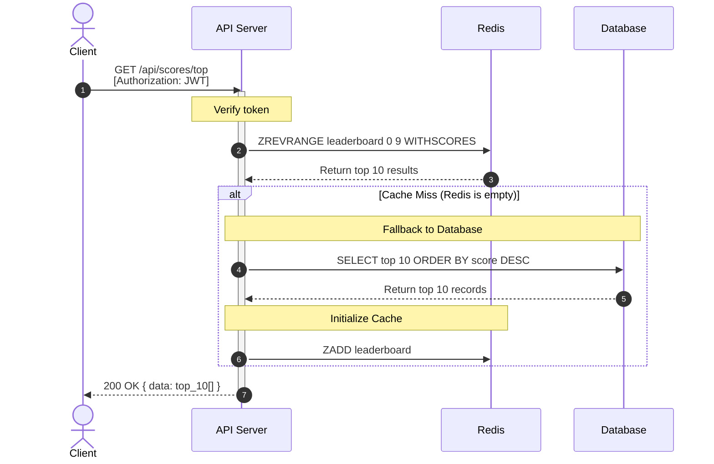
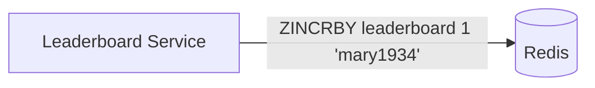
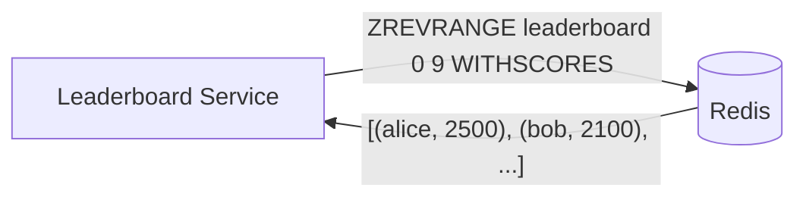
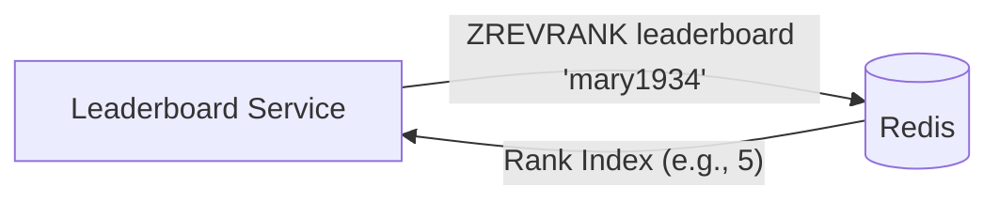
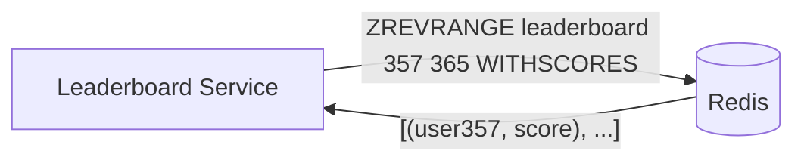

# Scoreboard Module - Backend API Specification


Write the specification for a software module on the API service (backend application server).

1. Create a documentation for this module on a `README.md` file.
2. Create a diagram to illustrate the flow of execution. 
3. Add additional comments for improvement you may have in the documentation.
4. Your specification will be given to a backend engineering team to implement.

### Software Requirements

1. We have a website with a score board, which shows the top 10 user’s scores.
2. We want live update of the score board.
3. User can do an action (which we do not need to care what the action is), completing this action will increase the user’s score.
4. Upon completion the action will dispatch an API call to the application server to update the score.
5. We want to prevent malicious users from increasing scores without authorisation.

### Table of Contents

- [Design Considerations & Trade-offs](#design-considerations--trade-offs)
- [Architecture Overview](#architecture-overview)
- [Execution Flow](#execution-flow)
- [API Design](#api-design)
- [Data Model](#data-model)
- [Security Design](#security-design)
- [Improvement Recommendations](#improvement-recommendations)

---

## Design Considerations & Trade-offs

- **Why Redis over PostgreSQL `ORDER BY`?**
  - *Issue:* Leaderboard datasets can become massive. Executing a real-time `ORDER BY` SQL query on millions of rows for every score update or read request is highly inefficient, leading to severe performance bottlenecks, slow indexing, and high database CPU load.
  - *Decision:* Redis Sorted Sets (`ZSET`) provide `O(log N)` complexity for inserts and rank lookups, making real-time leaderboard updates blazing fast even at extreme scale.
- **Handling Massive Leaderboard Queries:**
  - *Issue:* Fetching or broadcasting the entire leaderboard is network and memory intensive.
  - *Decision:* Limit live WS broadcasts to the Top 10 users. For users outside the top tier, only fetch their specific rank and immediate neighbors on demand.
- **Performance vs. Durability (Dual-Storage):**
  - *Trade-off:* In-memory data (Redis) is volatile; SQL Databases are durable but slow for live rankings.
  - *Decision:* Use an SQL Database as the absolute Source of Truth (append-only ledger) and Redis purely as a highly-available, rebuildable cache view.
- **Idempotency & Concurrent Updates:**
  - *Issue:* Network retries or malicious spamming could award users duplicate points.
  - *Decision:* Enforce strict idempotency using a client-generated unique key (`action_id`) enforced via a unique constraint in the `score_history` table.
- **Data Consistency (DB to Redis Sync):**
  - *Issue:* Ensuring Redis and Database stay synchronized if a process crashes.
  - *Decision:* **Write-Through Cache** pattern. The API updates the SQL Database within a transaction first. Only upon DB success does it update Redis. If Redis data is lost, it can be seamlessly rebuilt from the `leaderboard` table.
- **Client-Side Profile Fetching (Separation of Concerns):**
  - *Issue:* The leaderboard data structure strictly maps `user_id` to `score`. Hydrating `username` and `avatar_url` on the backend requires maintaining synchronized profile caches in Redis.
  - *Decision:* The Leaderboard API will strictly return `user_id`, `score`, and `rank`. The frontend client is responsible for resolving and caching user profile details (via a separate User Service). This decouples the leaderboard logic from user management.
- **Audit & History Ledger:**
  - *Issue:* Tracking *why* and *when* a user's score changed is critical for dispute resolution and analytics.
  - *Decision:* Every score change is recorded in an append-only `score_history` table. This serves as an immutable audit log to reconcile scores or track down malicious activities.

---

## Architecture Overview

[](https://excalidraw.com/#json=uAmFJtvH62f7aSv8PviDf,ZLQmwiF8FRi1aGXivVWZnA)
*<small>[Click to view diagram in Excalidraw](https://excalidraw.com/#json=uAmFJtvH62f7aSv8PviDf,ZLQmwiF8FRi1aGXivVWZnA)</small>*

### Component Responsibilities

| Component | Role |
|---|---|
| **Browser Client** | Renders scoreboard UI, triggers user actions, maintains WebSocket connection for live updates |
| **API Server** | Authenticates requests, validates score updates, persists data, broadcasts leaderboard changes |
| **Redis** | Caches the top-10 leaderboard in a Sorted Set for O(log N) reads; relays Pub/Sub events across server instances |
| **Database (SQL)** | Durable storage for user records and score history; source of truth |

---

## Sequence Flow

### Score Update Flow



### Live Scoreboard Broadcast Flow



### Initial Page Load Flow



---

## API Design

All endpoints require authentication via `Authorization: Bearer <JWT>` header.

### `POST /api/scores/claim` - Claim Points

Triggers score calculation and updates the authenticated user's score upon completing a valid action. The score service validates the action, calculates the awarded points internally, and updates the leaderboard.

**Request Body:**

```typescript
interface ClaimPointsRequest {
  action_id: string; // Unique identifier for the completed action (used for idempotency and points calculation)
}
```

**Success Response (200 OK):**

```json
{
  "success": true,
  "status": 200,
  "data": {
    "user_id": "u_abc123",
    "score": 1500,
    "rank": 3
  }
}
```

**Error Responses:**

| Status | Condition | Response Body |
|---|---|---|
| `400` | Missing or invalid `action_id` | `{ "success": false, "status": 400, "error": { "message": "Invalid action_id" } }` |
| `401` | Missing or expired JWT | `{ "success": false, "status": 401, "error": { "message": "Unauthorized" } }` |
| `409` | Duplicate `action_id` (already processed) | `{ "success": false, "status": 409, "error": { "message": "Action already processed" } }` |

---

### `GET /api/scores/top` - Get Top 10 Leaderboard

Returns the current top 10 users sorted by score descending. This is the primary source of truth for the initial page load.

**Success Response (200 OK):**

```json
{
  "success": true,
  "status": 200,
  "data": [
    { "rank": 1, "user_id": "u_xyz789", "score": 2500 },
    { "rank": 2, "user_id": "u_def456", "score": 2100 },
    { "rank": 3, "user_id": "u_abc123", "score": 1500 }
  ]
}
```

---

### `WebSocket /ws/scoreboard` - Live Leaderboard Stream

Establishes a persistent connection for real-time leaderboard push notifications. 

**Connection:**

```
ws://localhost:3000/ws/scoreboard?token=<JWT>
```

**Server-to-Client Message Format:**

```typescript
interface LeaderboardEvent {
  event: "leaderboard";
  data: {
    rank: number;
    user_id: string;
    score: number;
  }[];
}
```

- Emitted whenever any user's score changes in a way that affects the top-10 ranking.
---

## Data Model

### Relational Database Schema

**Users Table:**
Stores persistent user profiles.
| Column | Type | Description |
|---|---|---|
| `id` | `VARCHAR` | Unique user identifier (Primary Key) |
| `username` | `VARCHAR` | Display name |
| `avatar_url` | `VARCHAR` | URL to user's profile image |

**Leaderboard Table:**
Stores current aggregate scores for fast retrieval.
| Column | Type | Description |
|---|---|---|
| `user_id` | `VARCHAR` | Reference to Users table (Primary Key / Unique) |
| `score` | `INTEGER` | Current total points |

**Score History Table:**
An append-only ledger for auditability and idempotency.
| Column | Type | Description |
|---|---|---|
| `action_id` | `VARCHAR` | Unique identifier for the action (Unique Constraint) |
| `user_id` | `VARCHAR` | Reference to Users table |
| `points` | `INTEGER` | Points awarded for this action |
| `created_at` | `TIMESTAMP` | When the action was processed |

### Database Operations

**A user claims points (insert action & update score):**
```sql
BEGIN;

-- Record historical transaction
INSERT INTO score_history (action_id, user_id, points, created_at) 
VALUES ('<action_id>', '<user_id>', <points>, NOW());

-- Update current leaderboard score
INSERT INTO leaderboard (user_id, score) 
VALUES ('<user_id>', <points>)
ON CONFLICT (user_id) 
DO UPDATE SET score = leaderboard.score + EXCLUDED.score;

COMMIT;
```

**Find user's rank:**
```sql
SELECT 
    RANK() OVER (ORDER BY score DESC) as rank, 
    user_id, 
    score
FROM leaderboard
LIMIT 10;
```

| rank | user_id | score |
|---|---|---|
| 1 | u_happy_tomato | 987 |
| 2 | u_mallow_07 | 902 |
| 3 | u_smith_john | 870 |
| 4 | u_mary_1934 | 850 |


### Redis Data Structures

We use a Redis **Sorted Set** (e.g., `leaderboard`) as our primary data structure for the real-time leaderboard. It stores `user_id` as the member and `score` as the score, providing efficient `O(log N)` ranking operations.

**Data Structure Representation:**
```text
Redis Sorted Set (Key: "leaderboard")
+-------------------+---------+----------------------------+
| Member (user_id)  |  Score  | Index/Rank (ZREVRANK)      |
+-------------------+---------+----------------------------+
| "alice_789"       |  2500   | 0 (Top Score)              |
| "bob_456"         |  2100   | 1                          |
| "charlie_123"     |  1500   | 2                          |
+-------------------+---------+----------------------------+
```

#### Workflow with Sorted Sets

**1. A user scores a point**
When a user wins or completes an action, they score points. We call `ZINCRBY` to increment the user's score or add them to the set if they are new.



**Redis Query:**
```bash
ZINCRBY leaderboard 1 "mary1934"
```

**2. A user fetches the top 10 global leaderboard**
We call `ZREVRANGE` to obtain members in descending order. Using `WITHSCORES` ensures we get both user IDs and their total points.



**Redis Query:**
```bash
ZREVRANGE leaderboard 0 9 WITHSCORES
```

**3. A user wants to fetch their leaderboard position**
To show a specific user their current rank, we call `ZREVRANK`.



**Redis Query:**
```bash
ZREVRANK leaderboard "mary1934"
```

**4. Fetch the relative position in the leaderboard**
To show "players around me", we find the user's rank and then fetch a range. For example, if rank is 361, we fetch indices 357 to 365.



**Redis Query:**
```bash
ZREVRANGE leaderboard 357 365 WITHSCORES
```

---

## Security Design

### Authentication

- All REST endpoints and WebSocket connections require a valid **JWT** issued by the authentication service.
- JWT payload must contain: `{ sub: user_id, exp: expiration }`.
- Tokens are verified using a shared secret or public key on every request.

### Authorization

- A user can only update **their own** score. The `user_id` is extracted from the JWT, not from the request body. This prevents users from impersonating others.

### Idempotency (Anti-Cheat)

Each score update must include a client-generated unique `action_id` (e.g., UUID). We enforce strict idempotency to prevent duplicate score increments from replayed or malicious requests:

- The `score_history` table uses a **Unique Constraint** on the `action_id` column.
- If a request with a duplicate `action_id` is received, the database will trigger a unique constraint violation.
- The server catches this error and responds with `409 Conflict`, discarding the duplicate request.
- This ensures that replaying the same API call (either by network retry or malicious intent) does not inflate scores.

### Rate Limiting

- Apply per-user rate limiting (e.g., 10 score updates per minute) at the API gateway or middleware layer to throttle automated abuse.

### Input Validation

- `action_id` must be a non-empty string with a maximum length (e.g., 255 characters).
- Reject any request body with unexpected or extraneous fields.

---

## Improvement Recommendations

### Action Verification Service

Currently, the API trusts the client to report action completion honestly. A more robust design would have:
- The action system itself (game server, quiz engine, etc.) issue a **signed token** upon action completion.
- The score update endpoint verifies this signed token before crediting points.
- This moves trust from the client to a server-to-server verification, eliminating client-side forgery entirely.

### Batch Score Reconciliation

Periodically recalculate scores from a persistent audit log and reconcile against the Redis Sorted Set. This detects and corrects any drift caused by race conditions or partial failures.

### Horizontal Scaling

- Redis Pub/Sub enables broadcasting across multiple API server instances.
- **Sticky Sessions:** Implement sticky sessions (session affinity) at the load balancer level to ensure WebSocket stability and consistent data streaming for connected clients.
- For very high throughput, consider buffering score updates in a message queue (e.g., RabbitMQ, Kafka) and processing them asynchronously via a dedicated worker. This decouples the write path from the request lifecycle.

### Leaderboard Pagination

The current design only serves top 10. To support a full paginated leaderboard (e.g., "show me my rank and neighbors"), use `ZREVRANGE` with offset/count parameters and expose a `GET /api/scores?page=N&limit=M` endpoint.

### Score History and Audit Trail

For production environments requiring auditability, the `score_history` table (append-only ledger) logs every score event. This enables historical analysis, dispute resolution, and anomaly investigation.
