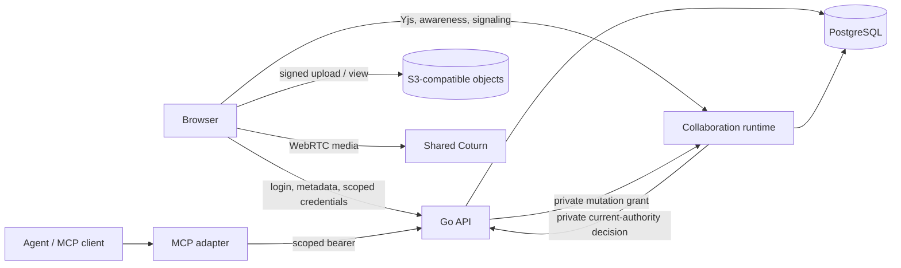

# Architecture: Whiteboard collaboration

## Implementation and deployment status

This document describes the collaboration-v2 release candidate. Production still runs v1 until the recorded VM100 cutover. Access/dashboard, durable persistence, browser transport, presence/follow/voice, agent commands and native rendering have passed local acceptance. The production rollout remains. See the [release checklist](../operations/RELEASE_CHECKLIST.md) for current gates and [real-stack verification](../work/verification/collaboration-v2-real-stack.md) for evidence boundaries.

The tenant is a workspace. There is no separate organization hierarchy. Dashboard components reuse the original reference layout, colors and light/dark tokens. The scene retains native Excalidraw styling.

## Services and trust boundaries

| Component | Responsibility | Authority and storage |
| --- | --- | --- |
| React/Vite frontend | Workspace management, native canvas, recovery UI | No database/service keys; short-lived scoped room credentials |
| Go API | Password login, workspace/scene permissions, invitations, metadata, asset capabilities, agent keys | Authoritative current PostgreSQL roles/grants; workspace-lock-first transactions |
| Node collaboration runtime | Authenticated WebSocket content, awareness, follow and voice signaling | One active runtime owner; durable Yjs log/receipts/snapshots in PostgreSQL |
| Node MCP adapter | HTTP/stdio agent tools, diagram compilation and export | Scoped agent bearer through Go; bounded adapter audit and renderer resources |
| S3-compatible store | Image bytes | Short-lived scene-authorized upload/view URLs |
| Shared Coturn | WebRTC media relay | Short-lived API-issued credentials; shared server remains outside this stack |
| Optional AI provider | Chat/image-to-diagram through an OpenAI-compatible API | Server-side configured key; native diagram presets do not require a provider |

Public nginx routes `/api` to Go, `/collab` to Node WebSocket and `/mcp` to the MCP adapter. Private authority and mutation endpoints share an internal Docker network with no host ports; nginx rejects `/internal`. Data collaboration uses the custom socket, not RelayHub or WebRTC data channels. Legacy Socket.IO has been removed from the Go server, frontend dependencies and nginx routing.

## Authorization and transaction ordering

Go computes owner/editor/viewer membership and optional per-scene editor/viewer overrides. An override requires current membership. Owners alone manage access, invitations, public links and agent keys; owner membership cannot be removed or demoted. Client UI gating is supplementary to server checks.

Account JWTs, public scene sessions, room JWTs, mutation grants and service credentials have separate purposes. Public edit links create scene-only guest principals, not users or workspace memberships. Public credentials never replace the account login token. Invite acceptance is email-bound, single-use and expires after seven days; new-account registration atomically creates a personal workspace and invited membership.

Permission mutations lock the workspace, advance its decimal ACL version and issue commit-bound PostgreSQL notifications. Node obtains current Go authority before acquiring its database lock, then rechecks ACL/grant expiry while locked. It never calls Go while holding the workspace lock. Dedicated secrets separate login, room signing, internal authority, mutation grants and internal commands. See [authority contract](mutation-authority.md), [access decision](../decisions/0009-collaboration-access.md) and [public links](public-links.md).

## Durable content and single writer

Legacy scenes start with `writer_mode=v1`. Promotion validates and seeds a native Yjs document, retaining the original JSON/version. Failure leaves v1 intact. Once promoted, Go rejects whole-scene content PATCH with `COLLAB_REQUIRED`; browser and agent edits use the same durable Node writer. Disabling `COLLAB_V2_ENABLED` only stops new promotions.

Native element IDs, tombstones, files, app state and presentation order are represented by the shared document contract. The runtime validates untrusted candidate updates in resource-bounded workers. Update size is at most1MiB, materialized content25MiB and retained Yjs history64MiB. Per-principal document writes are limited to120/minute. Bounded reusable validators and serialized/coalesced room fanout passed the unchanged 50-client acceptance workload; exact protocol behavior is documented in [collaboration protocol](collaboration-protocol.md).

A successful transaction appends the update, permanent idempotency receipt and mutation audit and advances the sequence before ACK or publication. Request IDs bind exact principal and payload bytes. Lost-response retries return the existing receipt rather than duplicating mutation. Snapshots occur after100updates or five seconds with bounded, single-flight compaction.

Exclusive process ownership, shared transaction/exclusive handoff barriers and exact database-backend identity prevent a replaced owner publishing. LISTEN/ownership loss removes readiness and disconnects clients. Trash retains history; ordinary scene deletion must not be used as a reset mechanism.

## Browser persistence and native canvas

IndexedDB queues are isolated by principal/workspace/scene/document identity. The client persists before sending, retains immutable sent request IDs/bytes and removes entries only after durable acknowledgement. Offline content, pending Blob bytes and recovery exports remain separate from credentials. Revoke, downgrade or epoch mismatch retains recovery and prevents unauthorized replay.

The adapter applies field-level native changes; local undo excludes remote and agent edits. Image references enter the shared scene only after upload. Upload lifecycle/revision guards prevent stale callbacks from deleting another draft's recovery. Concurrent remote fields, local pending movement and reopen recovery now retain the newest compatible native image state. See [browser architecture](BROWSER_COLLABORATION.md).

Legacy HTTP fallback requires an explicit disabled/promotion-required result plus fresh v1 verification. Generic network failures and already-promoted scenes never activate a second writer. Legacy recovery is namespaced separately and cannot be automatically replayed into a new Yjs identity.

## Agents and native diagrams

Workspace owners issue hash-only stored agent keys with independent operation scopes and optional scene targets. No implicit scope or permission-management capability is granted. Go records authoritative operation audit; MCP writes a bounded fsynced adapter-observed journal. Stdio observations are client-controlled and are not authoritative server audit.

The diagram package exposes19typed native presets with deterministic layout and restricted Mermaid support. Agents mutate the same live scene with explicit expected sequence and stable request bytes. Stale revisions are conflicts, never automatic overwrite. Numeric activity cursors preserve bigint ordering.

SVG, PNG and Excalidraw JSON export use the current authorized durable projection. Native rendering uses pinned fonts/licenses and isolated Chromium processes, with parent-owned startup/termination and temporary-directory cleanup. Authenticated cached artifacts recheck current export permission. See [MCP guide](../user/agents.md), [catalog](../user/diagram-catalog.md) and the public Markdown surfaces under `src/frontend/public/docs/`.

## Deployment and recovery

Ship migrations7–13 together from the production v1 version6. Keep prior images, private configuration and a successfully restored database backup before applying migrations. Production uses one active collab runtime; scaling replicas requires a different ownership design.

Image rollback alone cannot recover promoted scenes. The bounded recovery procedure verifies an archive and creates a replacement scene with a new scene/document identity, retaining the original quarantined history. It refuses assets/images or scene-specific overrides until an operator maps them safely. Existing queued edits stay bound to their original scene. See [recovery runbook](../operations/collaboration-recovery.md).

The TypeScript7 workspace has one root lockfile. Build shared contracts and diagram package before dependents. Exact versions, remaining advisories and verified platforms belong in [dependency evidence](../work/verification/collaboration-dependencies.md). Package/container success does not replace full Go/browser/S3/MCP/voice acceptance.
