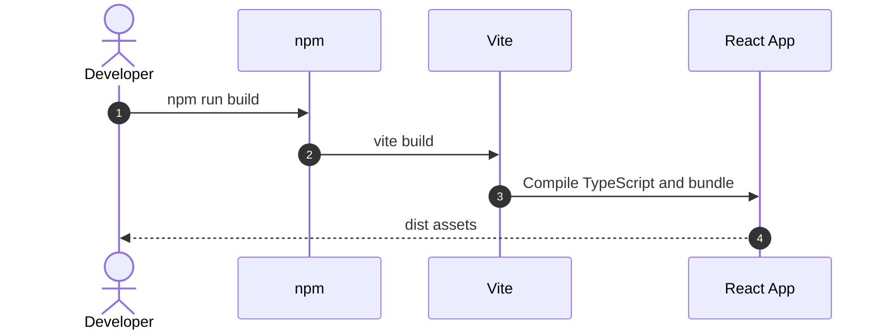

# Detail Design: Frontend Scaffold Vite React

## Status
Approved

## Associated Story
- **Story ID**: EXC-002
- **Story Link**: [EXC-002 Frontend Scaffold](EXC-002-frontend-scaffold-vite-react.md)

---

## 1. Design Considerations & Trade-offs
- **Manual Vite scaffold**:
  - *Issue/Challenge*: The repository already has story structure and staged docs changes; an interactive generator would add noise.
  - *Decision/Trade-off*: Create the Vite React TypeScript files directly and let `npm install` resolve the lockfile.
- **State boundary now, feature state later**:
  - *Issue/Challenge*: Phase 1 will add auth and workspace workflows in later tickets.
  - *Decision/Trade-off*: Add a small Zustand UI store and empty feature directories without implementing business state early.
- **Tailwind deferred**:
  - *Issue/Challenge*: EXC-005 owns Shadcn UI and Tailwind setup.
  - *Decision/Trade-off*: Use plain CSS for the scaffold so EXC-002 stays focused on Vite, React, and core dependencies.

---

## 2. Architecture Overview

### Component Responsibilities
| Component | Responsibility / Role |
| --- | --- |
| **Frontend (React)** | Owns SPA bootstrap, dashboard shell, and client-side component structure. |
| **State (Zustand)** | Provides a minimal UI store for active workspace selection. |
| **API Client (Axios)** | Centralizes HTTP base URL configuration for later backend calls. |

---

## 3. Sequence / Execution Flow



---

## 4. API Specification

No new backend API endpoints are introduced in EXC-002. The frontend includes an axios client configured by `VITE_API_BASE_URL` for future tickets.

---

## 5. Data Model & Storage Design

No persistent data model changes are introduced in EXC-002.

---

## 6. Security Design
- **Authentication**: No auth flow in this ticket.
- **Authorization**: No tenant enforcement in this ticket.
- **Input Validation**: No user-submitted forms in this ticket.
- **Secrets**: Browser-facing configuration uses only `VITE_*` public environment variables.

---

## 7. Verification & Test Plan

### Automated Verification
- **Frontend Build Command**: `cd dashboard && npm run build`
- **Dependency Check Command**: `cd dashboard && npm list react zustand vite axios lucide-react`

### Manual Verification Scenarios
- [ ] Start the frontend with `cd dashboard && npm run dev`.
- [ ] Open the dev server URL and confirm the dashboard shell renders.

---

## 8. Review and Sign-off
- **Reviewer**: Repository harness
- **Review Date**: 2026-06-04
- **Reviewer Decision**: Approved
- **Reviewer Comments**:
  ```text
  Scope is limited to React Vite scaffold, core dependency wiring, and build proof.
  ```
