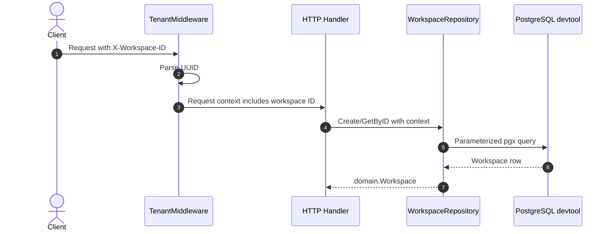

# Detail Design: Tenant Middleware and Workspace Repository

## Status
Under Review

## Associated Story
- **Story ID**: EXC-004
- **Story Link**: [EXC-004 Tenant Middleware & Workspace Repository](EXC-004-tenant-middleware-and-workspace-repository.md)

---

## 1. Design Considerations & Trade-offs
- **Header-based workspace selection**:
  - *Issue/Challenge*: Auth is not implemented yet, but repository filtering needs a workspace scope.
  - *Decision/Trade-off*: Use `X-Workspace-ID` as the temporary tenant boundary input and validate it as a UUID.
- **Typed context helper**:
  - *Issue/Challenge*: Raw context keys are easy to misuse across packages.
  - *Decision/Trade-off*: Keep a private key type in middleware and expose `GetWorkspaceID(ctx)` for retrieval.
- **Repository owns SQL, domain owns contract**:
  - *Issue/Challenge*: Clean Architecture requires SQL details to stay out of domain entities.
  - *Decision/Trade-off*: Implement `src/backend/internal/repository/postgres.WorkspaceRepository` with pgx and map rows into `domain.Workspace`.
- **Test without requiring global app server**:
  - *Issue/Challenge*: Middleware should be unit-testable without PostgreSQL; repository needs database behavior.
  - *Decision/Trade-off*: Add table-driven middleware tests and repository tests using the local `devtool` database or a pgx test pool.

---

## 2. Architecture Overview

### Component Responsibilities
| Component | Responsibility / Role |
| --- | --- |
| **HTTP Middleware** | Extracts, validates, and injects workspace ID into request context. |
| **Domain** | Defines repository interface and workspace entity shape. |
| **Postgres Repository** | Implements create/read workspace operations using pgx. |
| **Tests** | Prove UUID validation, context injection, and repository persistence behavior. |

---

## 3. Sequence / Execution Flow



---

## 4. API Specification

No new resource endpoint is introduced in EXC-004. Middleware behavior applies to future authenticated workspace routes.

### Header Contract
- **Header**: `X-Workspace-ID`
- **Format**: UUID
- **Missing/Invalid Response**: `400 Bad Request` from middleware for routes that require tenant scope.

---

## 5. Data Model & Storage Design

### Repository Operations
```sql
INSERT INTO workspaces (id, name, owner_id, created_at, updated_at)
VALUES ($1, $2, $3, $4, $5);

SELECT id, name, owner_id, created_at, updated_at
FROM workspaces
WHERE id = $1;
```

### Context Access
- `TenantMiddleware(next http.Handler) http.Handler`
- `WorkspaceIDFromContext(ctx context.Context) (uuid.UUID, bool)`

---

## 6. Security Design
- **Authentication**: Not implemented here; future auth will bind user identity to workspace membership.
- **Authorization**: This ticket validates tenant scope format only. Membership checks are future auth/authorization work.
- **Input Validation**: Invalid or missing `X-Workspace-ID` returns `400` before handler execution.
- **SQL Injection**: Repository uses parameterized pgx queries only.
- **Data Isolation**: Repository methods accept context so future methods can require workspace scope.

---

## 7. Verification & Test Plan

### Automated Verification
- `go test -v ./src/backend/internal/delivery/http/middleware/...`
- `go test -v ./src/backend/internal/repository/postgres/...`

### Manual Verification Scenarios
- [ ] Send request without `X-Workspace-ID`; expect middleware rejection.
- [ ] Send request with invalid UUID; expect middleware rejection.
- [ ] Send request with valid UUID; expect handler receives the UUID from context.
- [ ] Create and read workspace against local `devtool` database.

---

## 8. Review and Sign-off
- **Reviewer**: Human reviewer
- **Review Date**: 2026-06-04
- **Reviewer Decision**: Pending
- **Reviewer Comments**:
  ```text
  Pending review before implementation.
  ```
