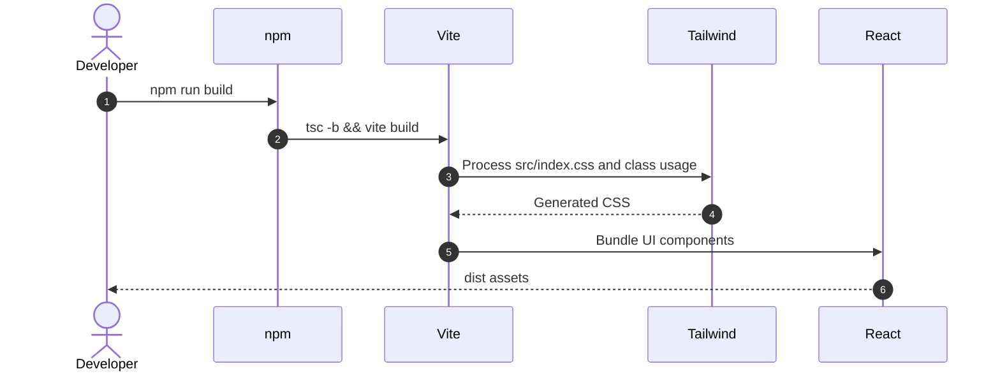

# Detail Design: Shadcn UI and Tailwind Setup

## Status
Approved

## Associated Story
- **Story ID**: EXC-005
- **Story Link**: [EXC-005 Shadcn UI & Tailwind Setup](EXC-005-shadcn-ui-and-tailwind-setup.md)

---

## 1. Design Considerations & Trade-offs
- **Manual Shadcn initialization**:
  - *Issue/Challenge*: The CLI is optimized for interactive project setup, while this repo already has a Vite scaffold and active story state.
  - *Decision/Trade-off*: Add `components.json`, Tailwind config, utility helpers, dependencies, and core components directly.
- **Tailwind v3 config compatibility**:
  - *Issue/Challenge*: The story expects `tailwind.config.ts`, which matches the stable Shadcn/Tailwind v3 setup.
  - *Decision/Trade-off*: Use `tailwindcss@3.4.17` with `postcss` and `autoprefixer`.
- **Core component portability**:
  - *Issue/Challenge*: Components must compile in Vite and use the local alias structure.
  - *Decision/Trade-off*: Use `@/lib/utils` and `@/components/ui/*` aliases via Vite and TypeScript config.

---

## 2. Architecture Overview

### Component Responsibilities
| Component | Responsibility / Role |
| --- | --- |
| **Tailwind** | Provides design tokens, utility generation, and CSS variable theme mapping. |
| **Shadcn primitives** | Wrap Radix primitives and class variants into reusable UI components. |
| **Dashboard App** | Consumes the core UI components to prove they compile and render together. |

---

## 3. Sequence / Execution Flow



---

## 4. API Specification

No backend API endpoints are introduced in EXC-005.

---

## 5. Data Model & Storage Design

No database or storage changes are introduced in EXC-005.

---

## 6. Security Design
- **Authentication**: No auth behavior in this ticket.
- **Authorization**: No tenant enforcement in this ticket.
- **Input Validation**: UI primitives do not submit data yet.
- **Dependency Boundary**: New packages are limited to Tailwind, Shadcn utility packages, and Radix primitives required by the listed components.

---

## 7. Verification & Test Plan

### Automated Verification
- **Frontend Build Command**: `cd dashboard && npm run build`
- **Dependency Check Command**: `cd dashboard && npm list tailwindcss @radix-ui/react-slot @radix-ui/react-dropdown-menu @radix-ui/react-dialog @radix-ui/react-scroll-area class-variance-authority clsx tailwind-merge`

### Manual Verification Scenarios
- [ ] Start the frontend with `cd dashboard && npm run dev`.
- [ ] Confirm the dashboard shell renders with Tailwind styling and Shadcn buttons/cards/menus.

---

## 8. Review and Sign-off
- **Reviewer**: Repository harness
- **Review Date**: 2026-06-04
- **Reviewer Decision**: Approved
- **Reviewer Comments**:
  ```text
  Scope is limited to Tailwind/Shadcn foundation and core UI primitives.
  ```
