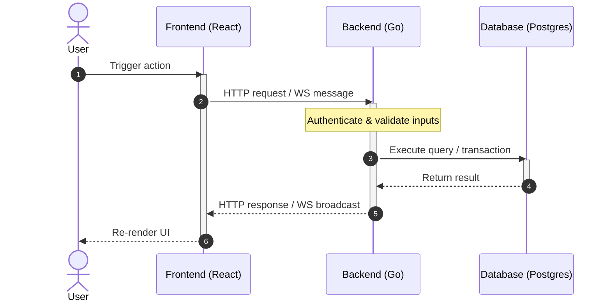

# Detail Design: [Feature/Module Name]

## Status
[Draft | Under Review | Approved | Rejected]

## Associated Story
- **Story ID**: [e.g., EXC-001]
- **Story Link**: [Link to Story File](file:///absolute/path/to/story.md)

---

## 1. Design Considerations & Trade-offs
*Document key design considerations, alternative approaches analyzed, and architectural trade-offs made.*
- **[Consideration/Alternative 1]**:
  - *Issue/Challenge*: [What problem are we trying to solve?]
  - *Decision/Trade-off*: [Why did we choose this approach over others? (e.g., Redis vs SQL, Local vs S3)]
- **[Consideration/Alternative 2]**:
  - *Issue/Challenge*: ...
  - *Decision/Trade-off*: ...

---

## 2. Architecture Overview
*Provide a high-level description of component responsibilities and layout.*

### Component Responsibilities
| Component | Responsibility / Role |
| --- | --- |
| **Backend (Go)** | [Role of Go backend (e.g., Usecase orchestrator, Postgres repository)] |
| **Frontend (React)** | [Role of React frontend (e.g., Zustand store, Tailwind UI, Socket client)] |
| **Database / Storage** | [Role of DB / S3 / Redis (e.g., PostgreSQL persistence, MinIO storage)] |

---

## 3. Sequence / Execution Flow
*Use Mermaid sequence diagrams to visualize the interactions between components, clients, services, and databases.*



---

## 4. API Specification
*Detail the API endpoints and communication protocols required by the story.*

### HTTP Endpoints
All endpoints require authentication unless specified otherwise.

- **[METHOD] `/api/v1/...`** - [Short Description]
  - **Auth Required**: [Yes/No (e.g., Bearer JWT)]
  - **Request Payload**:
    ```typescript
    interface RequestPayload {
      // TypeScript definition of request body
    }
    ```
  - **Success Response (200 OK / 201 Created)**:
    ```json
    {
      "success": true,
      "status": 200,
      "data": {}
    }
    ```
  - **Error Responses**:
    | Status Code | Condition | Response Body |
    | --- | --- | --- |
    | `400` | Invalid request parameters | `{ "success": false, "status": 400, "error": { "message": "..." } }` |
    | `401` | Missing or expired token | `{ "success": false, "status": 401, "error": { "message": "Unauthorized" } }` |

### WebSockets / Real-time Events (if applicable)
- **Path**: `/ws/...`
- **Payload Format**:
  ```typescript
  interface WebSocketMessage {
    event: string;
    data: any;
  }
  ```

---

## 5. Data Model & Storage Design
*Define the database schemas, query logic, and caching structures.*

### Relational Schema (PostgreSQL)
- **[Table Name]**:
  | Column | Type | Constraints | Description |
  | --- | --- | --- | --- |
  | `id` | `UUID` | PRIMARY KEY, DEFAULT gen_random_uuid() | Unique identifier |
  | ... | | | |

### Database Operations (SQL Queries)
```sql
-- Specify critical queries or transactions
BEGIN;
-- insert or update query
COMMIT;
```

### Cache Design (Redis - if applicable)
- **Data Structure**: [Sorted Set, Hash, String, etc.]
- **Key Pattern**: `[key-prefix]:[id]`
- **Cache Sync Policy**: [Write-Through, Cache-Aside, Write-Back]

---

## 6. Security Design
- **Authentication**: [JWT verification, context injection details]
- **Authorization**: [Multi-tenancy boundary checks, e.g., tenant_id match]
- **Idempotency**: [Anti-replay token, unique constraint checks]
- **Rate Limiting**: [Limits at gateway or middleware level]
- **Input Validation**: [Validation rules, regex, field limits]

---

## 7. Verification & Test Plan
*Detailed verification steps for automated tests and manual smoke checks.*

### Automated Verification
- **Unit Test Command**: `go test -v ./src/backend/internal/...`
- **Frontend Test Command**: `cd dashboard && npm run build`

### Manual Verification Scenarios
- [ ] Scenario 1: [Step-by-step verification instructions]
- [ ] Scenario 2: [...]

---

## 8. Review and Sign-off
- **Reviewer**: [Name of Reviewer]
- **Review Date**: [YYYY-MM-DD]
- **Reviewer Decision**: [Approved / Request Changes]
- **Reviewer Comments**:
  ```text
  [Detailed feedback or approval notes from reviewer]
  ```
