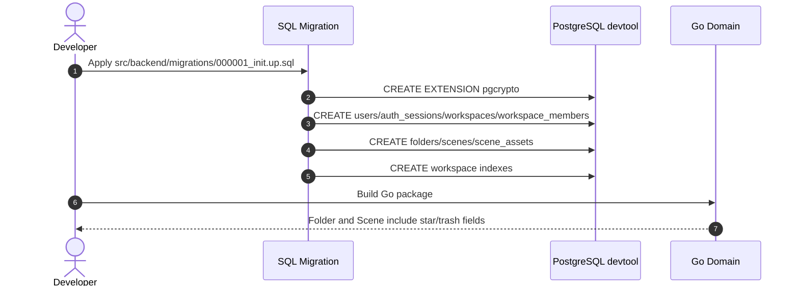

# Detail Design: DB Migrations and Multi-tenant Schema

## Status
Implemented; Pending Review

## Associated Story
- **Story ID**: EXC-003
- **Story Link**: [EXC-003 DB Migrations & Multi-tenant Schema](EXC-003-db-migrations-and-multi-tenant-schema.md)

---

## 1. Design Considerations & Trade-offs
- **App-specific database**:
  - *Issue/Challenge*: The local PostgreSQL service uses `dev/password`, but the app should own a separate database.
  - *Decision/Trade-off*: Target the existing `devtool` database created during EXC-001 validation.
- **UUID generation in Postgres**:
  - *Issue/Challenge*: Tables need UUID primary keys without forcing Go to generate every ID.
  - *Decision/Trade-off*: Enable `pgcrypto` and use `gen_random_uuid()` defaults in the migration.
- **Soft delete over hard delete**:
  - *Issue/Challenge*: Folder and scene trash behavior is planned in Phase 1.
  - *Decision/Trade-off*: Add nullable `deleted_at` columns and keep queries responsible for filtering active records in repository tickets.
- **Materialized folder path**:
  - *Issue/Challenge*: Folder tree navigation needs efficient descendant lookup.
  - *Decision/Trade-off*: Store `path` as text with workspace-scoped indexes; stricter path operations can be added later if needed.
- **Asset metadata ownership**:
  - *Issue/Challenge*: The reference server has a generic `files` table and stores file metadata without workspace or scene ownership.
  - *Decision/Trade-off*: If EXC-003 includes asset schema, create `scene_assets` as metadata-only storage with `workspace_id`, `scene_id`, `asset_kind`, `file_id`, bucket/key metadata, and no raw bytes or base64 `dataURL` in PostgreSQL.

---

## 2. Architecture Overview

### Component Responsibilities
| Component | Responsibility / Role |
| --- | --- |
| **Migration SQL** | Creates extensions, tables, constraints, and tenant indexes. |
| **Domain Entities** | Mirrors persistence fields needed by repositories without SQL annotations. |
| **PostgreSQL** | Enforces primary keys, foreign keys, uniqueness, and tenant indexes. |

---

## 3. Sequence / Execution Flow



---

## 4. API Specification

No HTTP API endpoints are introduced in EXC-003.

---

## 5. Data Model & Storage Design

### Relational Schema (PostgreSQL)
The implemented migration follows the canonical
[Phase 1 Database Design](../../../product/phase-01-database-design.md). The
summary below captures the core tenant-owned tables and lifecycle fields; the
migration also includes `auth_sessions`, `workspace_members`, and `scene_assets`
for Phase 1 auth and asset workflows.

- **users**
  | Column | Type | Constraints | Description |
  | --- | --- | --- | --- |
  | `id` | `UUID` | PRIMARY KEY, DEFAULT `gen_random_uuid()` | User identity |
  | `email` | `TEXT` | NOT NULL UNIQUE | Login email |
  | `name` | `TEXT` | NOT NULL | Display name |
  | `avatar_url` | `TEXT` | NULL | Profile image URL |
  | `google_id` | `TEXT` | UNIQUE NULL | Future Google OAuth subject |
  | `created_at` | `TIMESTAMPTZ` | NOT NULL DEFAULT `now()` | Creation timestamp |
  | `updated_at` | `TIMESTAMPTZ` | NOT NULL DEFAULT `now()` | Update timestamp |

- **workspaces**
  | Column | Type | Constraints | Description |
  | --- | --- | --- | --- |
  | `id` | `UUID` | PRIMARY KEY, DEFAULT `gen_random_uuid()` | Tenant boundary |
  | `name` | `TEXT` | NOT NULL | Workspace name |
  | `owner_id` | `UUID` | NOT NULL REFERENCES `users(id)` | Workspace owner |
  | `created_at` | `TIMESTAMPTZ` | NOT NULL DEFAULT `now()` | Creation timestamp |
  | `updated_at` | `TIMESTAMPTZ` | NOT NULL DEFAULT `now()` | Update timestamp |

- **folders**
  | Column | Type | Constraints | Description |
  | --- | --- | --- | --- |
  | `id` | `UUID` | PRIMARY KEY, DEFAULT `gen_random_uuid()` | Folder ID |
  | `workspace_id` | `UUID` | NOT NULL REFERENCES `workspaces(id)` | Tenant scope |
  | `parent_id` | `UUID` | NULL REFERENCES `folders(id)` | Tree parent |
  | `name` | `TEXT` | NOT NULL | Folder name |
  | `path` | `TEXT` | NOT NULL | Materialized path |
  | `is_starred` | `BOOLEAN` | NOT NULL DEFAULT false | Starred marker |
  | `deleted_at` | `TIMESTAMPTZ` | NULL | Trash marker |
  | `created_at` | `TIMESTAMPTZ` | NOT NULL DEFAULT `now()` | Creation timestamp |
  | `updated_at` | `TIMESTAMPTZ` | NOT NULL DEFAULT `now()` | Update timestamp |

- **scenes**
  | Column | Type | Constraints | Description |
  | --- | --- | --- | --- |
  | `id` | `UUID` | PRIMARY KEY, DEFAULT `gen_random_uuid()` | Scene ID |
  | `workspace_id` | `UUID` | NOT NULL REFERENCES `workspaces(id)` | Tenant scope |
  | `folder_id` | `UUID` | NULL REFERENCES `folders(id)` | Containing folder |
  | `name` | `TEXT` | NOT NULL | Scene title |
  | `data` | `JSONB` | NOT NULL DEFAULT `'{}'::jsonb` | Excalidraw payload |
  | `is_starred` | `BOOLEAN` | NOT NULL DEFAULT false | Starred marker |
  | `deleted_at` | `TIMESTAMPTZ` | NULL | Trash marker |
  | `created_by` | `UUID` | NULL REFERENCES `users(id)` | Creator |
  | `created_at` | `TIMESTAMPTZ` | NOT NULL DEFAULT `now()` | Creation timestamp |
  | `updated_at` | `TIMESTAMPTZ` | NOT NULL DEFAULT `now()` | Update timestamp |

### Indexes
- `idx_folders_workspace_id`
- `idx_folders_workspace_path`
- `idx_scenes_workspace_id`
- `idx_scenes_workspace_folder_id`

### Asset Implementation Note
Asset persistence must follow [Phase 1 Database Design](../../../product/phase-01-database-design.md).
Do not recreate the old reference `files` table as a generic unscoped blob store.
When asset schema lands, use `scene_assets` with:

- `workspace_id` for tenant isolation.
- `scene_id` for scene ownership or staged upload attachment.
- `asset_kind` with Phase 1 values `excalidraw_file` and `scene_thumbnail`.
- `file_id` for Excalidraw image element `FileId` mapping.
- `storage_bucket` and namespaced `storage_key`.
- `mime_type`, `byte_size`, optional `sha256`, optional dimensions.

PostgreSQL stores asset metadata only. Binary bytes and base64 `dataURL` payloads
must stay out of Postgres and belong in S3-compatible storage.

---

## 6. Security Design
- **Authentication**: Not implemented in this ticket.
- **Authorization**: Schema carries `workspace_id`; enforcement happens in EXC-004 repositories/middleware.
- **Input Validation**: SQL constraints reject missing required fields and invalid foreign keys.
- **Data Isolation**: Tenant-specific tables are indexed by `workspace_id` to support repository filtering.
- **Asset Isolation**: Asset rows must carry `workspace_id`; signed URL generation later must verify workspace scope before returning object access.

---

## 7. Verification & Test Plan

### Automated Verification
- `grep -i "is_starred" src/backend/migrations/000001_init.up.sql`
- `grep -i "deleted_at" src/backend/migrations/000001_init.up.sql`
- If asset schema is included: `grep -i "scene_assets" src/backend/migrations/000001_init.up.sql`
- If asset schema is included: `grep -i "asset_kind" src/backend/migrations/000001_init.up.sql`
- `go test ./src/backend/internal/domain/...`

### Manual Verification Scenarios
- [ ] Apply migration to local `devtool` database.
- [ ] Confirm `folders` and `scenes` include `workspace_id`, `is_starred`, and `deleted_at`.
- [ ] If asset schema is included, confirm `scene_assets` includes `workspace_id`, `scene_id`, `asset_kind`, `file_id`, `storage_bucket`, and `storage_key`, with no `data` or `data_url` column.
- [x] `go test ./...` passed from `src/backend`.
- [x] Grep checks confirmed `is_starred`, `deleted_at`, `scene_assets`, and `asset_kind` in the migration.
- [x] Grep check confirmed no `data_url`, `dataURL`, `bytea`, raw asset, or base64 storage in migration/domain files.

---

## 8. Review and Sign-off
- **Reviewer**: Human reviewer
- **Review Date**: 2026-06-04
- **Reviewer Decision**: Pending
- **Reviewer Comments**:
  ```text
  Pending review before implementation.
  ```
